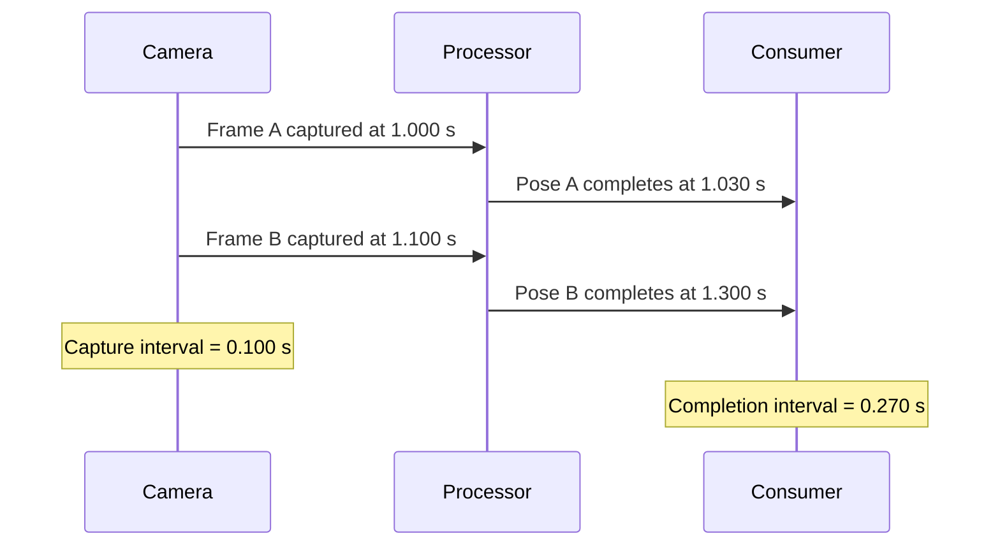

# ধারা · Dhara

**A displacement does not become a velocity because its field says `m/s`.**

Dhara means a stream or flow. This case comes from my preserved perception experiments: a broad engine with features, depth, tracking, visual odometry and mapping. Its odometry state has a velocity field labelled metres per second. One short assignment decides what that field actually contains.

This is a new, focused numerical reconstruction of the supplied source, not a new field trial or a restoration of the historical live application. It complements [Matra](https://github.com/fh1m/matra): that case asks where the metre comes from; this one asks where the second went.

## Run the case

Python 3.11+ and NumPy are sufficient. From this checkout:

```bash
python -m venv .venv
.venv/bin/python -m pip install -e .
.venv/bin/python -m dhara
.venv/bin/python -m unittest discover -s tests -v
```

An existing uv-managed environment without pip can install with `uv pip install --python /path/to/its/python -e .` instead. The replay command itself uses no camera, telemetry, GPU, model weights, ROS installation or network inference.

The command prints and writes [`results/controlled.json`](results/controlled.json), including the input definitions, software versions, before/after vectors and rejected timestamp cases. `--output path.json` selects another receipt location.

## The source-level contract

The preserved [`VOState`](origin/perception-system/core/types.py#L215-L242) declares:

```python
# Velocity estimate (m/s)
velocity: np.ndarray = field(default_factory=lambda: np.zeros(3))
```

But [`VisualOdometry.process`](origin/perception-system/odometry/visual_odometry.py#L162-L171) assigns:

```python
if len(self.pose_history) > 0:
    prev_pos = self.pose_history[-1][:3, 3]
    self.state.velocity = self.state.position - prev_pos
```

There is no elapsed-time denominator in that block. If the positions are metric, their difference is a displacement in metres between accepted pose updates—not metres per second. The informal phrase “metres per update” describes its cadence dependence; it does not supply the missing time unit.

The supported baseline executes exactly this unchanged guarded assignment in a small wrapper. Controlled state containers supply known positions and a previous pose matrix. It does **not** instantiate the neural feature extractors or claim to execute the complete `process` method. The complete original modules remain available beside it, with their SHA-256 identities in [`provenance.json`](provenance.json).

## Hold the motion fixed; change the accepted interval

The constructed motion is a constant **0.5 m/s along x**, starting at a nonzero position. Every supplied pose is already metric and correct by construction. This removes feature matching and scale recovery from the question.

| Nominal accepted updates/s | Interval | Stored x displacement, really m | Timestamp-based x velocity, m/s |
| ---: | ---: | ---: | ---: |
| 10 | 100 ms | 0.050000 | 0.500000 |
| 25 | 40 ms | 0.020000 | 0.500000 |
| 50 | 20 ms | 0.010000 | 0.500000 |
| 60 | 16.666667 ms | 0.008333 | 0.500000 |

Values here are rounded for reading; the receipt retains the float64 outputs. The 60 Hz interval is rounded to integer nanoseconds, and its constructed position uses that same interval. These are controlled arithmetic results, not a measured camera frame rate or vehicle speed.

The original field becomes smaller as updates become more frequent, even though the supplied physical motion stays the same. A consumer following its `m/s` comment would interpret a change in cadence as a change in velocity.

Dividing by elapsed seconds gives the finite-interval average:

$$
\bar{\mathbf v}_i = \frac{\mathbf p_i - \mathbf p_{i-1}}{t_i-t_{i-1}}.
$$

For integer-nanosecond capture timestamps, the implementation uses:

$$
\bar{\mathbf v}_i = (\mathbf p_i-\mathbf p_{i-1})\frac{10^9}{t_{i,ns}-t_{i-1,ns}}.
$$

This does not turn an incorrect pose into a correct one. It makes the time denominator explicit once the spatial inputs have earned their units and frame convention.

## A nominal frame rate is not the missing measurement

The original method has early returns for insufficient features, insufficient matches and failed pose recovery. Pose history is appended after an accepted update. The preceding stored pose is therefore not guaranteed to be the immediately preceding camera frame.

Multiplying every displacement by a configured `30` would only repair the special case of exactly 30 accepted, evenly spaced observations per second. It would be wrong after skipped frames, processing backlogs or a different capture rate.

The replay also supplies accepted capture gaps of **20, 40, 200, 50 and 690 ms**. For the same constructed constant motion, the archived x displacements range from **0.010 to 0.345 m**. The timestamp-based interval averages remain 0.5 m/s to floating-point precision. Every pair and result is retained in the receipt; there is no outlier removal.

The necessary interval belongs to the **two accepted source observations**, not to an assumed loop frequency.

## Even a positive interval can describe the wrong events

Adding `time.time()` around processing is not enough. A pose describes the scene at an observation instant; its result can finish much later.

The controlled example supplies these event times:



The known displacement is 0.05 m. Using capture times recovers **0.5 m/s**. Using the completion interval produces approximately **0.185185 m/s**. Both intervals are positive; a monotonicity check cannot discover that the latter names the wrong events.

These completion times are experiment inputs, not measured inference latencies. The purpose is to expose a semantic contract that the subtraction alone cannot enforce. `capture_ns` must genuinely belong to the source observation, and both timestamps must come from the same clock domain.

## The corrected interface is deliberately small

[`velocity_between`](dhara/velocity.py) takes two three-component positions and their integer-nanosecond capture timestamps:

```python
from dhara.velocity import velocity_between

v = velocity_between(
    [3.0, -2.0, 1.0], [3.05, -2.0, 1.0],
    1_000_000_000, 1_100_000_000,
)
# approximately [0.5, 0.0, 0.0] m/s
```

Its contract is narrower than a complete odometry system:

- Positions must already be in metres and the same fixed coordinate frame. The function cannot infer either fact from a three-number array.
- Timestamps must be integer nanoseconds, strictly increasing, and refer to the two capture instants in one clock domain.
- Duplicate and backwards timestamps are refused with `ValueError`; there is no zero-velocity substitute or guessed frame-rate denominator. Noninteger timestamps raise `TypeError`.
- Nonfinite or wrongly shaped positions are refused. Unrepresentable float64 arithmetic raises `FloatingPointError` rather than returning an infinite velocity.
- Integer timestamps are subtracted **before** floating-point conversion. The regression includes a 100 µs interval on a large clock epoch, which would be vulnerable to unnecessarily converting both absolute timestamps to float first.
- Neither pose input is mutated; the returned velocity has independent storage.

The function computes an **interval average**. Under acceleration that is not generally the instantaneous velocity at the newer frame. It also does not estimate covariance, filter pose noise, detect every clock-domain mix-up or decide what to do with stale data.

A real caller must discard/reseed an observation pair after an incompatible clock jump rather than differentiating across it. ROS simulated time can pause or jump backwards; the existence of a timestamp field is not evidence of a continuous, initialized clock.

## What this establishes—and what it does not

The numerical counterexample establishes that this particular archived assignment stores displacement in a field documented as velocity. The replacement calculation preserves the expected rate under controlled changes in accepted capture cadence and refuses invalid numerical inputs.

It does **not** establish camera or underwater navigation accuracy, validate the historical neural models, repair camera/world pose conventions, recover a missing metric scale, or migrate the complete archived application. No physical vehicle was operated. The ROS bridge elsewhere in the archive is not used as evidence that this particular field reached a deployed odometry topic.

A robot can still be wrong after the units are right. But a rate calculation that omits time is already wrong before feature quality becomes the interesting question.

## Source and evidence layout

```text
dhara/                       controlled replay, unchanged baseline block, corrected rate calculation
origin/perception-system/
  odometry/visual_odometry.py complete original module
  core/types.py              original state/units contract
provenance.json              original relative paths and verified SHA-256 identities
results/controlled.json      actual outputs, capture pairs and software versions
tests/                       cadence, clock, finite-input and storage-isolation regressions
```

The application/integration modules were supplied from Fahim Faisal's work archive. OpenCV, NumPy, learned feature/depth implementations and their weights remain upstream work. The historical modules are retained unchanged; their Torch/model imports are not executed by the supported replay. No model weights or blanket redistribution license have been added to those snapshots.

## Further reading

- [ROS REP 103: Standard Units of Measure and Coordinate Conventions](https://www.ros.org/reps/rep-0103.html)—metres, seconds and explicit body/optical coordinate conventions. Correct time division is not a frame transform.
- [ROS 2 Clock and Time design](https://design.ros2.org/articles/clock_and_time.html)—system, steady and ROS time; replay, pauses and backwards jumps. Numerically ordered integers are not proof of a shared clock domain.
- [Matra: metric scale in the same archived perception family](https://github.com/fh1m/matra)—why dividing by seconds still cannot manufacture the metre in a scale-ambiguous reconstruction.

A useful stream carries more than numbers. It carries which observation they belong to, when it happened, and what their units mean.
